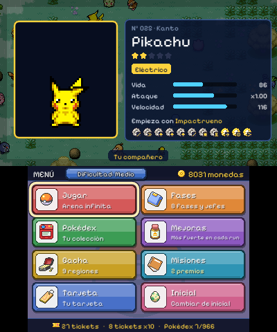
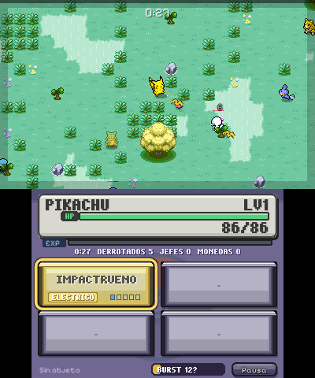
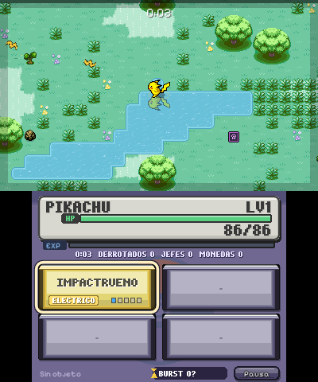
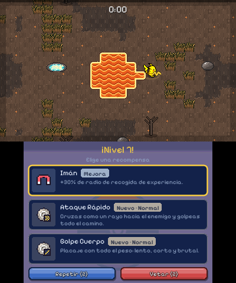
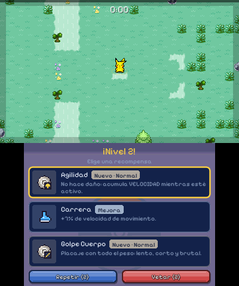
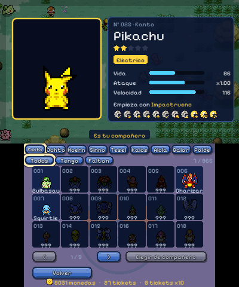
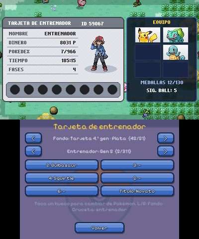

# PokéSurvivor 3DS

Port no oficial de [PokéSurvivor](https://github.com/JPTER78/pokesurvivor) (de JPTER78,
[pokesurvivor.com](https://pokesurvivor.com)) para Nintendo 3DS, escrito en Lua con
[LÖVE Potion](https://github.com/lovebrew/lovepotion) y empaquetado como `.3dsx` y `.cia`.
Usa las dos pantallas: arriba la partida y abajo un menú táctil al estilo de los juegos de DS.
Proyecto de fans sin ánimo de lucro; licencias y créditos en [LICENSE](LICENSE) y
[CREDITS.md](CREDITS.md).

## Capturas

Cada captura muestra las dos pantallas de la consola (arriba 400×240, abajo 320×240).

| | |
|:---:|:---:|
|  |  |
| Menú principal | Partida |
|  |  |
| Agua con reflejos | Mar de lava animado |
|  |  |
| Subida de nivel (repetir y vetar) | Pokédex |
|  | |
| Tarjeta de entrenador | |

## Estructura

```
game/          código Lua del juego (main.lua, conf.lua, src/, nest/ para PC)
assets/        icon.png (48x48), banner.png (256x128), banner.wav  -> metadatos del CIA
tools/         build.ps1 (3dsx + cia), run-pc.ps1, app.rsf (makerom), make_assets.py
lovebrew.toml  título/autor/versión (lo lee build.ps1 y el bundler web)
dist/          salida: PokeSurvivor.3dsx y PokeSurvivor.cia
```

## Pantallas

- **Superior (400x240)**: juego. `love.draw(screen)` con `screen ~= "bottom"`.
- **Inferior (320x240, táctil)**: HUD, menú de mejoras, pausa/reinicio.

## Comandos

```powershell
# Probar en PC (ventana con las dos pantallas simuladas por nest)
.\tools\run-pc.ps1

# Pruebas automáticas
.\tools\luacheck.ps1 -All            # sintaxis de todos los .lua
.\tools\smoke-test.ps1               # arranca y empieza una run (SMOKE_OK)
.\tools\soak-test.ps1 -Seconds 600   # 10 min de partida automática acelerada
.\tools\pc-shot.ps1 -GameArgs "--run --scale1" -Out build\pc.png   # captura de pantalla

# Argumentos de depuración del juego (love game <args>):
#   --run  --levelup  --die  --shiny  --ui=menu|dex|gacha|upgrades|goals|test|starters
#   --scale1 (ventana de nest a escala 1)  --smoke  --soak=N

# Regenerar datos y arte (Python 3 + Pillow)
python tools\pack_sprites.py <repo> --full-all   # atlas de Pokémon (normal, completo, shiny)
python tools\gen_tiles.py; python tools\gen_vfx.py; python tools\gen_icons.py; python tools\gen_pokedex.py

# Empaquetar para 3DS
.\tools\build.ps1            # 3dsx + cia
.\tools\build.ps1 -Target cia
```

## Assets para la consola

En 3DS LÖVE Potion solo carga imágenes `.t3x` y fuentes `.bcfnt`. `build.ps1` convierte
automáticamente `png/jpg` y `ttf/otf` de `game/`. En el código, carga con la extensión
según plataforma, por ejemplo:

```lua
local ext = love._console and ".t3x" or ".png"
local img = love.graphics.newImage("img/sprite" .. ext)
```

Límites: texturas de 3 a 1024 px por lado. Sin shaders. ~60 entidades en pantalla
es un objetivo razonable en una 3DS original.

## Instalar en la consola

- `.3dsx` → copiar a `sdmc:/3ds/` y abrir desde Homebrew Launcher.
- `.cia`  → instalar con FBI (requiere CFW, p. ej. Luma3DS).

## Port completo de pokesurvivor.com (en curso)

El juego se está rehaciendo como port fiel de la web (código MIT de JPTER78/pokesurvivor):
966 Pokémon, 64 movimientos, enemigos con personalidad, jefes, grietas, clima, objetos,
mejoras, gacha, misiones y logros, con guardado en la SD. Estado y pasos siguientes en
`docs/STATUS.md`; convenciones del port en `docs/PORT.md`.

## Estado de las pruebas (2026-10-11)

| Prueba | Resultado |
|---|---|
| PC, LÖVE 11.5 + nest (`tools\smoke-test.ps1`) | OK, sin errores de Lua |
| Generar `.3dsx` y `.cia` (`tools\build.ps1`) | OK |
| Instalar el `.cia` en Azahar (`azahar.exe --install`) | OK, aparece con icono y título |
| Ejecutar en Azahar | NO: LÖVE Potion (también el oficial) sale al arrancar; el emulador no está soportado |
| Consola real, CIA v1 del parche | FALLO: abre y se cierra sin dibujar. Causa: con argc = 0 `PHYSFS_init` recibía "embedded boot.lua" y `love.boot` abortaba en silencio |
| Consola real, CIA v2 del parche (`arg[-2] = "romfs:/"` + log en `sdmc:/lovepotion-error.log`) | OK (2026-10-11): instalado con FBI, carga y se ven las dos pantallas |

## Toolchain (ya instalado en este PC)

- `C:\devkitPro` (MSYS2 + 3ds-dev: tex3ds, mkbcfnt, 3dsxtool, smdhtool, devkitARM)
- `%USERPROFILE%\3ds-tools\bin` makerom 0.19, bannertool 1.2.3
- `%USERPROFILE%\3ds-tools\lovepotion-cia` LÖVE Potion 3.0.2 compilado con el parche
  "cargar juego desde romfs:/ cuando se ejecuta como título instalado" (fuente en
  `3ds-tools\src\lovepotion`, cambios en `source/main.cpp` y `scripts/arg.lua`).
- LÖVE 11.5 portable (`3ds-tools\love`), Azahar (`3ds-tools\azahar`), Git portable.

## Créditos de gráficos

- Código y diseño original: JPTER78/pokesurvivor (MIT); mecánicas y decoración de ruta de giovanneluna/poke-survivors (MIT).
- Suelo, hierba, flores y árboles de HeartGold/SoulSilver: tileset de SirMaio, versión de jls-dchrn/HGSS_pokemon_tileset (`tools/gen_hgss.py`).
- Sprites de objetos: PokeAPI.
- Tarjeta de entrenador: fondos y diseños propios (`tools/gen_card_art.py`, inspirados en las tarjetas de 3.ª, 4.ª y 5.ª gen); sprites oficiales de entrenadores de 3.ª-5.ª gen de la colección de Pokémon Showdown y sprites de Negro/Blanco de PokeAPI/sprites; Poké Balls de la mochila de PokeAPI (`tools/gen_badges.py`).
